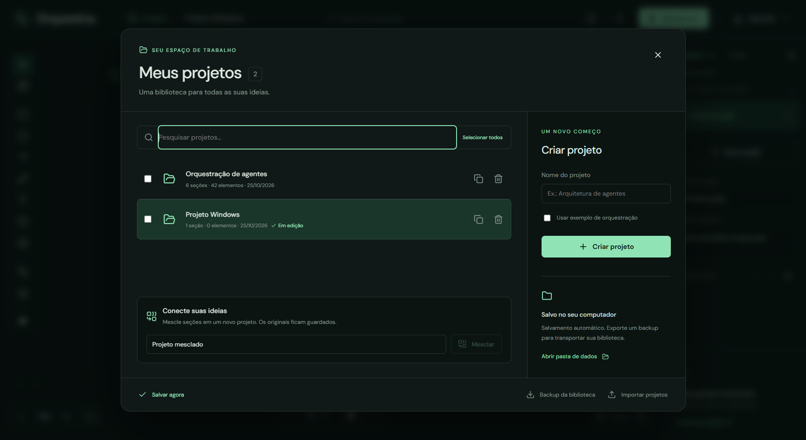
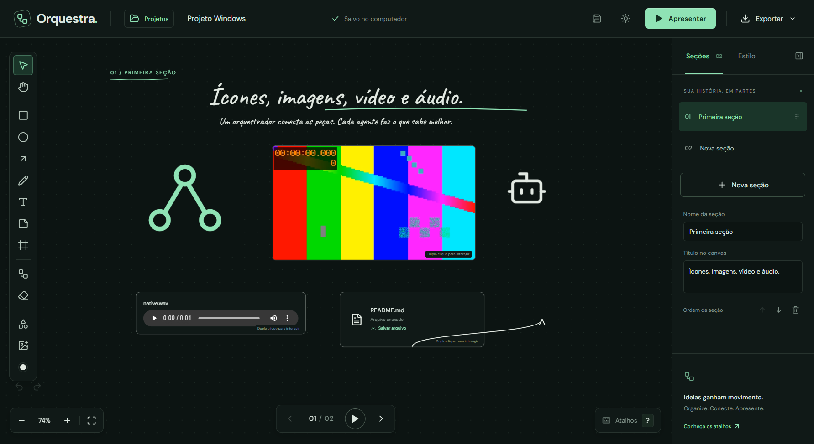

# Orquestra

Um quadro branco para desenhar e apresentar ideias. Nasceu porque eu queria explicar orquestração de agentes de IA com diagramas que se animam passo a passo, e acabou virando um editor completo. Roda no navegador ou como app de Windows, sem backend e sem chave de API.



## O que dá para fazer

- Desenhar num canvas livre com retângulos, elipses, setas, notas, texto, traço livre, molduras e cartões de "agente".
- Ligar elementos com conectores que acompanham quando você move ou redimensiona.
- Dividir o projeto em seções, cada uma com seu próprio canvas.
- Animar a entrada de cada elemento e o fluxo das setas, e apresentar em etapas (setas ou espaço para avançar).
- Colocar imagens, vídeos, áudio, PDFs, links e vídeos do YouTube no quadro.
- Alinhar, agrupar, travar e organizar por camadas; salvar estilos reutilizáveis e modelos de seção.
- Guardar versões do projeto e voltar a uma delas.
- Exportar a seção em PNG ou SVG, o quadro inteiro em PDF, e fazer backup da biblioteca em JSON.

O salvamento é automático: no navegador vai para o armazenamento local, e no app de Windows para `%APPDATA%\Orquestra`.



## Stack

React 19, TypeScript e Vite, com um editor SVG próprio (não usa tldraw nem Excalidraw). PDF.js para os PDFs, Lucide para os ícones e Electron para a versão desktop. Os testes usam o `node --test`.

## Rodando localmente

```bash
npm install
npm run dev        # abre em http://localhost:5173
npm test
npm run desktop    # compila e abre o app Electron
npm run dist:win   # gera o instalador Windows x64
```

## Mais documentação

Atalhos, detalhes de cada recurso e o roteiro de testes estão em [docs/MANUAL.md](docs/MANUAL.md). As fontes Caveat e DM Sans são servidas localmente e as licenças delas estão em `public/fonts/`.
